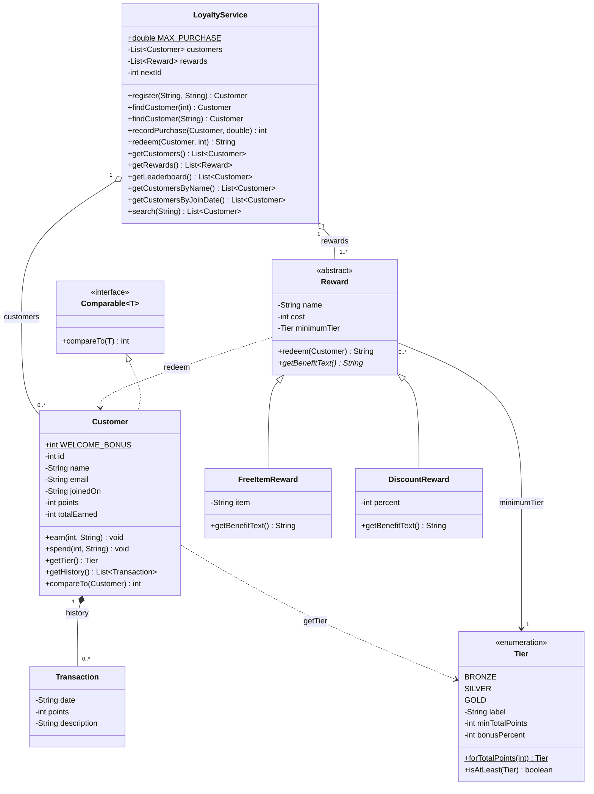
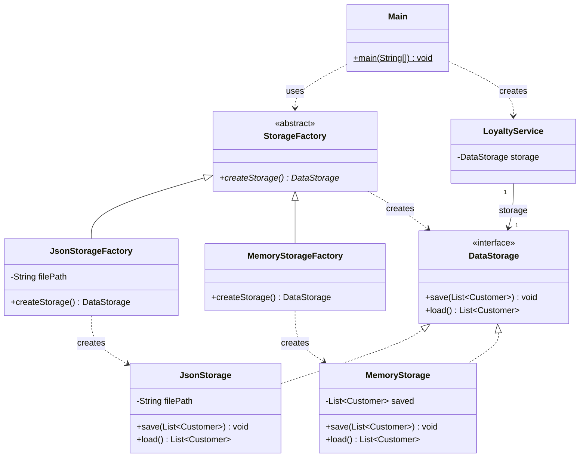
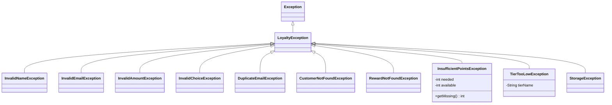

# UML class diagrams (draft)

This is the plan from Day 1. The diagrams are updated whenever the code changes, so that they match
the finished program.

They are written in [Mermaid](https://mermaid.js.org/), so GitHub shows them as pictures and the text
under each picture is the editable source. Notation: `+` public, `-` private, `*` abstract, `$` static.
Plain getters are left out to keep the pictures readable.

## 1. Domain and service

The things the shop talks about, and the class that holds the rules.

- `Reward.redeem` is the fixed skeleton: it checks the tier, takes the points, and then returns the
  text of the benefit. The one missing piece is `getBenefitText`, which each subclass fills in.
- The empty diamond is aggregation (the service holds customers and rewards). The filled diamond is
  composition (a transaction only exists as part of one customer).

## 2. Storage and the Factory Method pattern

How the data is saved. `Main` and the service only use the abstract types, never `new JsonStorage()`.

| Role in the Factory Method pattern | Class |
| --- | --- |
| Product (interface) | `DataStorage` |
| Concrete products | `JsonStorage`, `MemoryStorage` |
| Creator (abstract) | `StorageFactory` with the factory method `createStorage()` |
| Concrete creators | `JsonStorageFactory`, `MemoryStorageFactory` |

## 3. Exceptions

Every kind of error has its own class. All of them extend `LoyaltyException`, which is a checked
exception, so the compiler makes the caller handle them.

